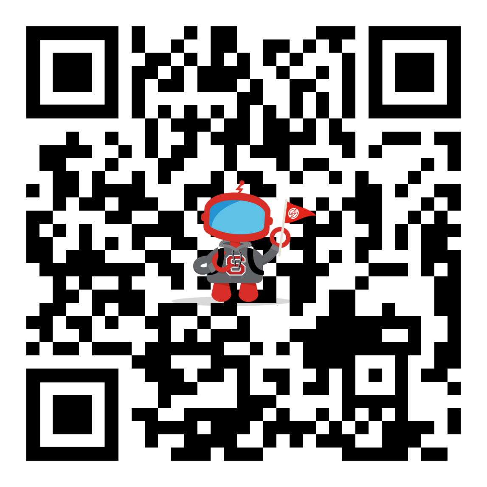

# my-demo-app-ios

*My Demo App* is a... demo app! 
It was built by the Sauce Labs team to showcase product capabilities of the Sauce Labs mobile devices cloud, The Sauce Labs mobile beta testing platform, TestFairy, and more products and technologies that will be added to this project soon.

This app is part of a set of demo apps.

[My Demo App - Android](https://github.com/saucelabs/my-demo-app-android)

[My Demo App - iOS](https://github.com/saucelabs/my-demo-app-ios)

### QR code scanner

This app has a QR code scanner.
You can find it in the menu under the option "QR CODE SCANNER".
This page opens the camera (you first need to allow the app to use the camera) which can be used to scan a QR Code.
If the QR code holds an URL it will automatically open it in a browser. The [following image](./docs/assets/qr-code.png)
can be used to demo this option.



## Publish

To publish a new version, create a release with a valid semver tag name. A CI workflow will handle setting the app version name/code and upload the APK into the release. 

## SDK credentials

The app runs Backtrace and the Sauce Mobile Beta SDK side by side.

1. Copy `Config/Local.xcconfig.example` to `Config/Local.xcconfig` and fill in `SAUCE_MOBILE_BETA_TOKEN`, `SAUCE_MOBILE_BETA_ENDPOINT` (both from Organization Settings > SDK Settings), `BACKTRACE_UNIVERSE` and `BACKTRACE_TOKEN`. The endpoint is the Server Endpoint (`https://<host>/services/`). The SDK's built-in default server is no longer in service, so without the endpoint the app skips Sauce Mobile Beta.

2. Build. `Config/Demo.xcconfig` includes your file, Xcode expands the values into Info.plist
   (`sauceMobileBetaToken`, `sauceMobileBetaEndpoint`, `backtraceUniverse`, `backtraceToken`) and `Credentials.swift` reads them.

## UI tests

### Sauce Visual

`VisualTest` uses [SauceVisual](https://github.com/saucelabs/visual-apple), added to the `MyDemoAppUITests` target as a Swift package. Open `My Demo App.xcworkspace`, whose `Package.resolved` pins the version.

`SauceVisual` is a dynamic framework and is set to **Embed & Sign** in the UI test target. Keep it that way: without it, tests pass on a simulator but fail on a device with `Library not loaded: @rpath/SauceVisual.framework/SauceVisual`.

The tests need `SAUCE_USERNAME` and `SAUCE_ACCESS_KEY`, and are skipped without them. These are separate from the SDK credentials in `Config/Local.xcconfig`.

- **Xcode:** add them under **Edit Scheme → Run → Arguments → Environment Variables**. The Test action uses them too. The scheme is shared, so don't commit it with your keys.
- **Terminal:** pass them with the `TEST_RUNNER_` prefix. For a device, use `-destination 'platform=iOS,id=<device-udid>'`.

```bash
TEST_RUNNER_SAUCE_USERNAME="$SAUCE_USERNAME" TEST_RUNNER_SAUCE_ACCESS_KEY="$SAUCE_ACCESS_KEY" \
  xcodebuild test -workspace "My Demo App.xcworkspace" -scheme "My Demo App" \
  -destination 'platform=iOS Simulator,name=iPhone 17 Pro' \
  -only-testing MyDemoAppUITests/VisualTest
```

To see a visual change, accept the first build's snapshots as baselines, then set `VISUAL_CHECK=true` (`TEST_RUNNER_VISUAL_CHECK=true` in the terminal). The test then logs in as `visual@example.com`, whose catalog looks different.
