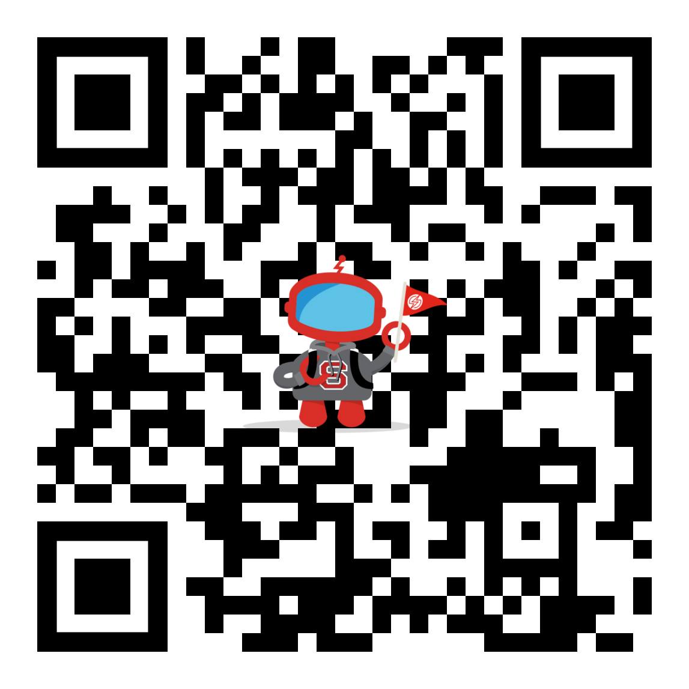

# my-demo-app-ios

*My Demo App* is a... demo app! 
It was built by the Sauce Labs team to showcase product capabilities of the Sauce Labs mobile devices cloud, The Sauce Labs mobile beta testing platform, TestFairy, and more products and technologies that will be added to this project soon.

This app is part of a set of demo apps.

[My Demo App - Android](https://github.com/saucelabs/my-demo-app-android)

[My Demo App - iOS](https://github.com/saucelabs/my-demo-app-ios)

### QR code scanner

This app has a QR code scanner.
You can find it in the menu under the option "QR CODE SCANNER".
This page opens the camera (you first need to allow the app to use the camera) which can be used to scan a QR Code.
If the QR code holds an URL it will automatically open it in a browser. The [following image](./docs/assets/qr-code.png)
can be used to demo this option.



## Publish

To publish a new version, create a release with a valid semver tag name. A CI workflow will handle setting the app version name/code and upload the APK into the release. 

## SDK credentials

The app runs Backtrace and the Sauce Mobile Beta SDK side by side.

1. Copy `Config/Local.xcconfig.example` to `Config/Local.xcconfig` and fill in `SAUCE_MOBILE_BETA_TOKEN`, `SAUCE_MOBILE_BETA_ENDPOINT` (both from Organization Settings > SDK Settings), `BACKTRACE_UNIVERSE` and `BACKTRACE_TOKEN`. The endpoint is the Server Endpoint (`https://<host>/services/`). The SDK's built-in default server is no longer in service, so without the endpoint the app skips Sauce Mobile Beta.

2. Build. `Config/Demo.xcconfig` includes your file, Xcode expands the values into Info.plist
   (`sauceMobileBetaToken`, `sauceMobileBetaEndpoint`, `backtraceUniverse`, `backtraceToken`) and `Credentials.swift` reads them.

## UI tests

### Sauce Visual

The UI tests use `SauceVisual` as a local Swift package at `../visual-sdks/visual-apple`, relative to this repo. Check out [visual-sdks](https://github.com/saucelabs/visual-sdks) next to this repo. `visual-apple` isn't on its `main` branch yet, so check out a branch that has it. If your checkout is somewhere else, link it from the root of this repo:

```bash
ln -s /path/to/visual-sdks ../visual-sdks
```

`SauceVisual` is a dynamic framework, so linking it to the UI test target is not enough: it has to be copied into the test bundle. `MyDemoAppUITests` has an **Embed Frameworks** build phase (Destination **Frameworks**, **Code Sign On Copy**) that copies it into `MyDemoAppUITests.xctest/Frameworks`. Keep that phase, and add the same phase to any other test target that uses the SDK. A Debug build on the simulator can load the framework from the build folder on your Mac, so a missing embed may only show up on a device.

`SauceVisual` needs `SAUCE_USERNAME` and `SAUCE_ACCESS_KEY`. These are separate from the SDK credentials in `Config/Local.xcconfig`. In Xcode, set them under **Edit Scheme → Test → Arguments → Environment Variables**. The **My Demo App** scheme is shared and committed, so don't commit it with your keys. With `xcodebuild`, pass them with the `TEST_RUNNER_` prefix instead, as described under **Credentials and region** in `visual-apple/README.md`.

### Running on a device

The app target signs each configuration differently:

- **Debug** uses automatic development signing with team `JWKXD469L2`, so Xcode can attach its debugger. The scheme's Test action builds Debug.
- **Release** uses manual signing with the `Sauce Labs iOS Demo App AdHoc Profile` profile for distribution.

Don't sign Debug with a distribution profile again. The **My Demo App** scheme has **Debug executable** on (**Edit Scheme → Test → Info**), so Xcode launches the app under test suspended, and its log says the debugger is responsible for resuming it. The debugger can only attach to an app with the `get-task-allow` entitlement. Xcode adds it when it signs for development, and distribution profiles such as Ad Hoc and App Store don't allow it. With a distribution-signed Debug build the attach fails and the test stalls (see [Common failures](#common-failures)).

CI's device builds don't use the Debug signing. Its signed builds use Release, its Debug device build is unsigned (`CODE_SIGNING_ALLOWED=NO`), and Sauce Labs re-signs apps on its real devices by default.

To see how a build is signed, print its entitlements and signing identity. In DerivedData, device builds are under `Build/Products/Debug-iphoneos`.

```bash
codesign -d --entitlements - --xml "<DerivedData>/Build/Products/Debug-iphoneos/My Demo App.app" | plutil -p -
codesign -dvv "<DerivedData>/Build/Products/Debug-iphoneos/My Demo App.app" 2>&1 | grep Authority
```

A development build shows `"get-task-allow" => true` and `Authority=Apple Development`. If you see `false` and `Authority=Apple Distribution`, the app was signed for distribution and Xcode can't attach to it. Xcode also logs the failed attach in the test's action log. Results are under `Logs/Test` in DerivedData:

```bash
xcrun xcresulttool get log --type action --path "<result>.xcresult" | grep get-task-allow
```

`xcodebuild` doesn't attach a debugger, so a distribution-signed app can pass from the command line while the same test stalls in Xcode. To run the Sauce Visual test on a device from the command line (`xcrun xctrace list devices` shows the device ID):

```bash
TEST_RUNNER_SAUCE_USERNAME="$SAUCE_USERNAME" TEST_RUNNER_SAUCE_ACCESS_KEY="$SAUCE_ACCESS_KEY" \
  xcodebuild test -workspace "My Demo App.xcworkspace" -scheme "My Demo App" \
  -destination 'platform=iOS,id=<device-udid>' \
  -only-testing MyDemoAppUITests/NavigationTest/testNavigateMoreToWebview
```

If a test passes there but stalls in Xcode, check the entitlements.

### Common failures

| Symptom | Cause | Fix |
|---|---|---|
| On a device, the tests fail at launch with `Library not loaded: @rpath/SauceVisual.framework/SauceVisual` | `SauceVisual.framework` isn't embedded in `MyDemoAppUITests.xctest` | On the **MyDemoAppUITests** target, open **Build Phases → + → New Copy Files Phase**, set **Destination** to **Frameworks**, add **SauceVisual**, and check **Code Sign On Copy** |
| In Xcode, the test stalls on `Setting up automation session`, later hangs at `Wait for com.saucelabs.mydemo.app.ios to idle`, and the action log says `The executable does not contain "get-task-allow" in its entitlements, so the debugger will fail to attach.` The same test passes with `xcodebuild` | The app is signed with a distribution profile | Sign Debug with automatic development signing, then check the entitlements as shown above |
| Package resolution fails with `the package at '…/visual-sdks/visual-apple' cannot be accessed` | The SDK isn't checked out at `../visual-sdks/visual-apple` | Check out `visual-sdks` next to this repo, or link it there as shown above |
